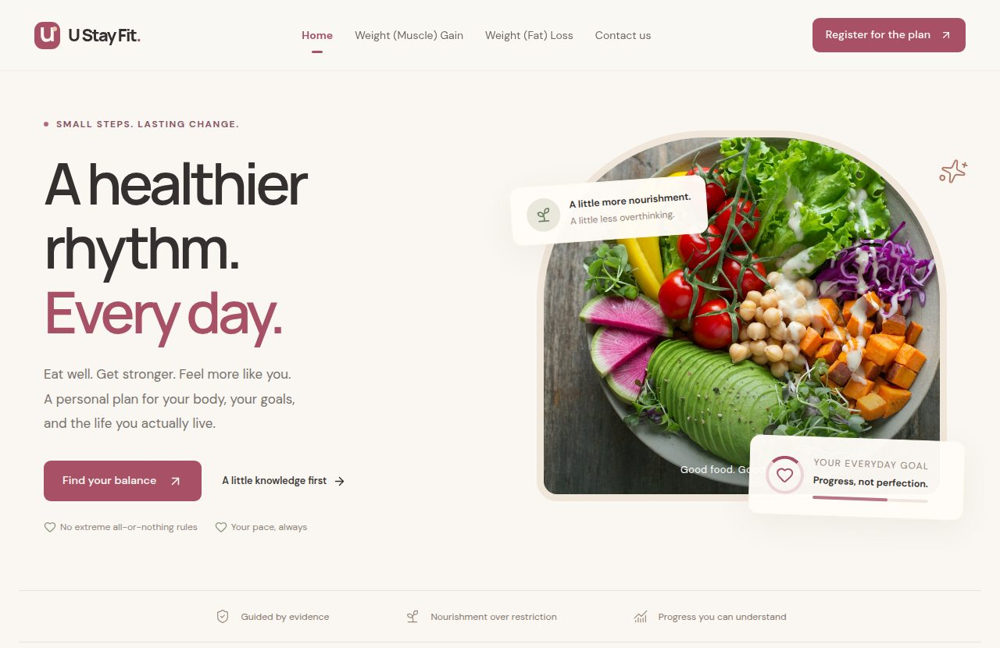
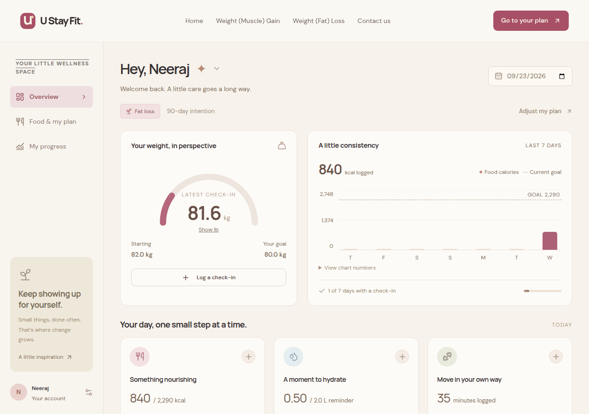
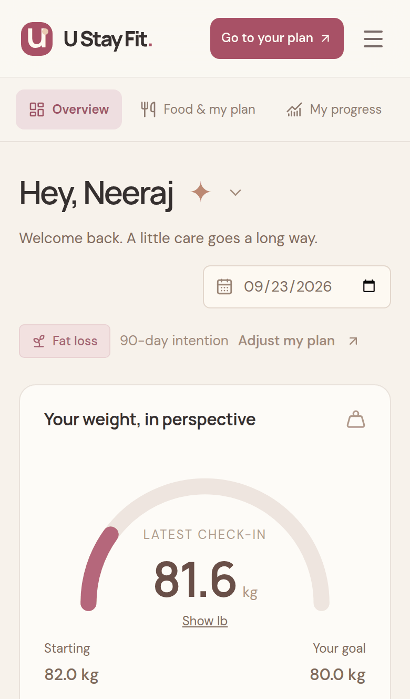

# U Stay Fit

Hey there! 👋

I'm **Neeraj Yadav**, a master's student in Computer Science at the University of Kansas. Thanks for stopping by!

Let me tell you about **U Stay Fit**, a project I'm really proud of. It's a full-stack wellness planner that I built from scratch, and it's live right now at **[ustay-fit.com](https://ustay-fit.com)**, so feel free to go try it out.



## So, what is U Stay Fit?

The idea is simple. You tell the app a few things about yourself (your height, weight, age and how active you are) and what you're going for: losing fat, building muscle, recomposition, or just maintaining. From that, it works out a realistic daily calorie target along with protein, carb and fat numbers to start from.

But a plan on its own doesn't get anyone fit. The hard part is sticking with it. So most of the app is about helping you keep going one small step at a time: logging your food, water, exercise and weight, and showing your progress in a way you can actually understand.

My goal was to build something real people could use every day, not just a class demo.

## What you can do with it

- **Get a plan built from your own numbers.** I used the Mifflin–St Jeor equation for resting energy, plus BMI, a Deurenberg body-fat estimate, Boer lean body mass, a protein-mass estimate and an optional Navy tape-measure body-fat check. If someone picks a goal that's too aggressive, the app caps it and explains why instead of quietly going along with it.
- **Log your day in a few seconds.** Food, water, exercise and weight check-ins, all editable, with kg/lb switching. There are also 36 meal ideas grouped by meal, including everyday Indian dishes.
- **See how you're doing.** A weekly calorie chart against your goal, your weight trend, body-composition history and a streak for the days you checked in.
- **Learn a little along the way.** Short guides on fat loss and muscle gain, and a carousel that busts 10 common fitness myths.
- **Stay in control of your data.** Nothing health-related is saved until you say yes. You can download everything the app holds about you as a PDF report (or JSON), and delete your account and every record with one click.
- **Sign in safely.** Email confirmation, password reset, breached-password checks, lockout after too many wrong tries, two-factor authentication with recovery codes, "sign out everywhere", and sign-in with Google (Facebook login is built in too).

| Dashboard on a laptop | Dashboard on a phone |
| --- | --- |
|  |  |

## How I built it

I worked on every part of this myself: the design, the frontend, the API, the database, the login and security side, the tests and the deployment. Here's what's under the hood:

| Part | What I used |
| --- | --- |
| Frontend | React 19, Vite, Tailwind CSS 4, React Router 7, and Motion for small animations. Fonts and photos are served by the app itself, so visiting the site makes no third-party requests. |
| Backend | Node.js 24 and Express 5, with Zod validation shared between the browser and the server |
| Database | PostgreSQL in production, split into three database roles that each only get the permissions they need. For local development I use PGlite (an embedded Postgres), with numbered SQL migrations. |
| Security | scrypt password hashing, hashed session tokens with idle and absolute timeouts, two-factor auth (TOTP) written from the RFC 6238 spec, AES-256-GCM encryption for secrets, rate limiting, strict security headers, CSRF protection and a security log with alerts |
| Testing | 65 API and unit tests with `node --test`, the same suite run against real PostgreSQL 17, and Playwright browser tests on desktop and phone |

If you're curious about the health formulas, their limits and where they come from, I wrote them all up in [docs/health-methodology.md](docs/health-methodology.md).

## Taking it live

This was my first time ever deploying a website on my own domain, so getting U Stay Fit online was a big step for me. The app runs in a Docker container (non-root and read-only) behind Caddy, which handles HTTPS automatically. It's hosted on a DigitalOcean server, the domain's DNS is on Cloudflare, and emails go out through Resend. Backups are encrypted, and every push to GitHub runs the tests, `npm audit` and a secret scan through GitHub Actions.

## Want to run it yourself?

You only need Node.js (22.12 or newer):

```sh
npm ci
npm run dev
```

Then open http://localhost:5173. That's it! In development the app uses an embedded database and prints confirmation links in the terminal instead of sending real emails.

- `npm test` runs the API and unit tests
- `npm run test:e2e` runs the browser tests

## A quick note on health

U Stay Fit gives general wellness information based on the numbers you enter. It's not medical advice, and it's meant for healthy adults. The app says this wherever it matters, and it won't suggest losing weight below a healthy BMI.

## Say hi!

Thanks for reading all the way down here! If you have feedback or ideas, or you just want to say hello, I'd love to hear from you.

- Email: ustayfit0916@gmail.com
- Instagram: [@ustay_fit_0916](https://www.instagram.com/ustay_fit_0916/)
- X: [@Ustayfit0916](https://x.com/Ustayfit0916)

Neeraj

## License

The code is released under the [MIT License](LICENSE). The photos come from Unsplash under the [Unsplash License](https://unsplash.com/license).
