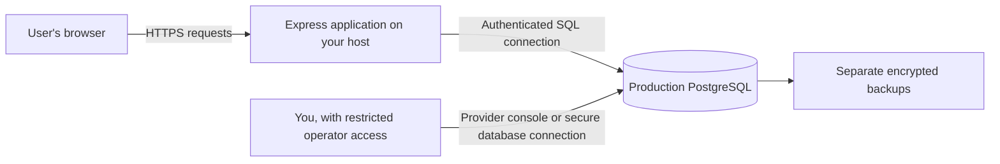

# U Stay Fit: pre-launch security review and data-storage guide

**Historical review — superseded implementation.** Reviewed September 22, 2026 before hardening. The findings and observations below describe the earlier code; line numbers are historical. The subsequent fixes, regression results, and remaining staging requirements are documented in [Security fixes and the path to launch](security-hardening.md). Do not interpret the old reproduced attacks as current test results.

The original recommendation was not to accept public users. The corrected application is now ready for private staging/provider testing. Public launch still depends on real hosting, email, OAuth, monitoring, and backup/restore verification.

## 1. What was reviewed and tested

The review covered the server routes, authentication and account management, session/token storage, password hashing, authenticator implementation, validation, SQL and migrations, frontend data rendering and recovery/account pages, Docker/Caddy settings, dependency configuration, backup scripts, operator tools, and privacy/deployment documentation.

| Check | Observed result |
| --- | --- |
| Existing calculation/API suite | **28 passed, 0 failed**, using a temporary in-memory PGlite database. The first sandboxed attempt could not open its test port; the permission-enabled rerun passed. |
| `npm run build` | Passed. |
| Live `npm audit --json` | **0 known reported vulnerabilities**. This checks the registry's dependency advisories, not application logic. |
| Targeted authentication probes | Five unwanted behaviors reproduced; one concurrency probe did not reproduce its suspected race. Details below. |
| Independent authenticator calculations | Six SHA-1 examples matched the six-digit reductions of the RFC 6238 reference vectors. This validates those calculations, not every surrounding sign-in flow. [RFC 6238](https://www.rfc-editor.org/rfc/rfc6238.html). |
| PostgreSQL TLS option handling | A synthetic, nonconnecting `pg.Client` confirmed that a connection URL containing `sslmode=disable` overrides an explicit `ssl: { rejectUnauthorized: true }` option. |
| Current environment, values not disclosed | Development mode; local PGlite; no external database, production application secret, real email transport, or Google/Facebook credentials configured in `.env`. |

The original isolated probes reproduced five unwanted behaviors on the earlier implementation. Their entry point, [security/probes.mjs](security/probes.mjs), now runs assertions for the corrected behavior:

```sh
node docs/security/probes.mjs
```

Use `npm test` for the complete suite and `npm run test:postgres` for the native PostgreSQL checks. No real user database is read by these test commands.

The native PostgreSQL deployment, cloud account permissions, actual public TLS connection, email delivery, provider logins, firewall, live backups, and restore process were not tested. No production hosting account was available to inspect. This is a code and local integration review, not a comprehensive independent penetration test or a legal/clinical assessment.

## 2. Original findings (see the linked resolution guide for current status)

### F1 — High: password recovery bypasses enabled two-factor authentication

**Location:** [server/auth.js](../server/auth.js), especially the password-reset handler around lines 270–293.

The normal login flow requires a second factor when enabled. The reset flow changes the password and immediately issues a full session, without checking that factor. The probe enabled two-factor authentication, followed a synthetic reset email, supplied no authenticator or recovery code, and received HTTP 200 from the private `/api/me` endpoint. The account still reported two-factor authentication enabled.

**Prerequisite and impact:** someone who obtains the reset link for controls the email account can enter the app without the independent authenticator. This is not a claim that an attacker can enter any account without obtaining a credential; it means the advertised second layer is bypassable through recovery.

**Correction:** after resetting a password, revoke existing sessions and pending authentication capabilities, then return the person to the normal password-plus-MFA flow. Define a separate, appropriately verified process for a person who has also lost their authenticator. Do not silently treat email recovery as MFA recovery. This follows [OWASP's password-recovery guidance](https://cheatsheetseries.owasp.org/cheatsheets/Forgot_Password_Cheat_Sheet.html).

### F2 — High: an active session can replace an already enabled authenticator

**Location:** [server/account.js](../server/account.js), setup and enable handlers around lines 71–110.

The server permits another setup even when an authenticator is already enabled. It gives the caller a new secret, then accepts a code generated from that newly supplied secret. It does not ask for the account password or a code from the previously enrolled authenticator. The probe performed both requests successfully using only the existing session cookie and the new secret.

**Prerequisite and impact:** a stolen or unattended signed-in session can change the account's second factor and invalidate existing recovery codes. Hiding the setup button in the page would not fix this; a caller can send the request directly.

**Correction:** require recent password verification plus an existing enrolled factor or approved recovery path for replacement; give pending enrollment a short expiry; notify the owner; revoke other sessions as appropriate. Review disabling MFA through the same policy. [OWASP recommends checking an existing factor rather than trusting a session alone](https://cheatsheetseries.owasp.org/cheatsheets/Multifactor_Authentication_Cheat_Sheet.html#changing-mfa-factors).

### F3 — High deployment issue: the documented Compose connection uses the database superuser

**Locations:** [compose.deploy.yml](../compose.deploy.yml), lines 8–10 and 25; [deployment instructions](deployment.md), the `DEPLOY_DATABASE_URL` example; [server/db.js](../server/db.js), automatic migrations.

The official PostgreSQL image creates the named `POSTGRES_USER` with superuser privileges. This project sets it to `u_stay_fit`, and its documented application connection uses that same user. Following the supplied example therefore gives the web application database-superuser access. No live PostgreSQL role was inspected; this finding concerns the default deployment recipe. [Official PostgreSQL image documentation](https://hub.docker.com/_/postgres).

**Impact:** a future server compromise or SQL injection would have a much larger scope than access to just the application's required rows. This does not mean an SQL injection was found in the current queries.

**Correction:** create separate roles for initial database administration, schema migrations, and ordinary application requests. The ordinary role should have only the table/sequence permissions required to run the app, with no superuser, role-creation, or database-creation privileges. Move migrations to a deployment step so the long-running application does not need schema-owner permissions. Use a separate read-only role for routine inspection. [PostgreSQL privileges](https://www.postgresql.org/docs/current/ddl-priv.html).

### F4 — Medium: credential changes do not revoke all related tokens

**Locations:** [server/account.js](../server/account.js), password change around lines 47–68; [server/auth.js](../server/auth.js), reset and sign-out-everywhere around lines 270–307.

Two behaviors were reproduced:

- A reset link requested before an ordinary password change remained valid afterward and could change the password again.
- A partially completed password/MFA sign-in remained valid after “Sign out everywhere”; submitting the valid second factor afterward created a fresh session.

Both require possession of the relevant earlier token, and the MFA case also requires a valid factor. Their remaining lifetimes are limited. Nevertheless, users trying to secure an account reasonably need a dependable way to revoke outstanding authentication capabilities.

**Correction:** invalidate appropriate reset, verification, and pending MFA tokens transactionally when credentials or account security state changes. Introduce an authentication-version field checked by sessions and pending challenges, or equivalent explicit revocation. Add tests that combine these flows, not only tests of each flow individually.

### F5 — Medium: deleting a provider-only account needs no fresh proof of identity

**Location:** [server/account.js](../server/account.js), lines 149–157.

Password accounts must provide the current password before deletion. Accounts without a local password skip that check. A synthetic provider-only account was deleted with an existing cookie and the word `DELETE`, without a fresh provider sign-in.

**Prerequisite and impact:** someone with a stolen or unattended social-login session can irreversibly delete the account and its records. Typing a confirmation word prevents some accidents but does not prove account ownership.

**Correction:** require a short-lived reauthentication result from the original provider before destructive account actions. Never substitute “there is no local password” for identity verification. [OWASP authentication guidance](https://cheatsheetseries.owasp.org/cheatsheets/Authentication_Cheat_Sheet.html#reauthentication-after-risk-events).

### F6 — Medium: password hashing uses a lower cost than current OWASP scrypt guidance

**Location:** [server/security.js](../server/security.js), lines 6–25.

The code correctly salts and hashes passwords, using scrypt with `N=32768`, `r=8`, `p=1`. OWASP's listed setting at that memory cost uses `p=3`; its higher-memory option uses `N=131072`, `r=8`, `p=1`. [OWASP password-storage guidance](https://cheatsheetseries.owasp.org/cheatsheets/Password_Storage_Cheat_Sheet.html#scrypt).

**Impact:** if password hashes are stolen, guessing candidates costs less than the cited baseline. This is not plaintext password storage, reversible encryption, or an immediate login bypass.

**Correction:** benchmark an appropriate recommended setting or Argon2id on the intended server, accounting for simultaneous logins and denial-of-service limits. Store the algorithm parameters/version with each hash and upgrade old hashes after successful login. Simply changing constants would break verification of existing hashes because their current encoding does not record the parameters.

### F7 — Medium configuration issue: database URL options can override the TLS setting

**Location:** [server/db.js](../server/db.js), lines 41–45; [deployment guide](deployment.md), database TLS explanation.

The code supplies both a connection string and an `ssl` object. The driver allows TLS-related URL parameters to replace that object. The nonconnecting probe confirmed that `sslmode=disable` removes TLS even when certificate verification was explicitly requested in the other option. [node-postgres documents this precedence](https://node-postgres.com/features/ssl#usage-with-connectionstring).

**Impact:** the statement “set DATABASE_SSL=true” alone is insufficient to guarantee a verified encrypted connection to a remote database. This requires a conflicting deployment URL; it is not a presently observed interception of local data. Plain traffic on the explicitly documented same-host private Docker network is a separate deployment choice.

**Correction:** make the deployment's TLS policy explicit, reject conflicting URL options, load a provider CA when needed, and verify the actual remote database connection. Do not fix certificate errors by disabling certificate checks.

### F8 — Medium operational issue: the backup passphrase is passed on the command line

**Locations:** [scripts/backup.sh](../scripts/backup.sh), line 15; [scripts/restore-test.sh](../scripts/restore-test.sh), the decryption command.

Both scripts pass the backup passphrase as a `gpg --passphrase` argument. The documented inline shell assignment can also enter shell history. Depending on host permissions and monitoring, process arguments can be visible to other tools or users.

**Impact:** protecting the backup file is less useful if its decryption secret is exposed alongside the backup workflow. No actual passphrase was read or leaked during this review.

**Correction:** use a properly protected secret input such as a dedicated file descriptor or secret-manager integration, set restrictive permissions before writing, and keep passphrases out of command history and logs. Schedule off-host backups and prove restoration before collecting public data.

## 3. Additional concerns and unverified boundaries

These are distinguished from the reproduced findings above:

- **MFA concurrency:** the code reads the challenge and last accepted time step before separate updates/deletion. This merits a transaction, row lock, or conditional update to ensure one-time use under concurrency. The two-request local probe returned 401 and 200, so a duplicate-session race was **not reproduced**. Retest with parallel native PostgreSQL connections and deliberate interleavings; do not call the local result proof of race freedom.
- **Email abuse and account discovery:** reset/resend/signup delivery is awaited inside the response. Known and unknown accounts take different code paths. Add queued delivery, per-recipient cooldowns and cost limits, and check timing behavior. The existing generic response wording does not prove timing resistance.
- **Rate-limit coverage:** the stricter sign-in limiter covers auth routes. Account password/MFA-management routes rely on the broader per-IP API limit; their failed reauthentication attempts do not share the database account lockout. Add account-scoped limits. The IP limiter uses process memory, so multiple app instances and restarts need a shared store or a verified edge limit. This review did not perform load or distributed-abuse testing.
- **Re-registration race:** registration checks that an account is unverified, then deletes it later by ID without retaining the unverified condition. A concurrent verification can change the state between those operations. Use a conditional transactional operation; this race was identified in code, not reproduced.
- **Security monitoring:** the source avoids printing request bodies and tokens in production errors, which is good. It does not provide a complete security-event trail and alerting system for recovery, factor changes, unusual access, and administrative actions. Cleanup errors are swallowed. Logs must support investigation without collecting unnecessary health data or secrets.
- **Backups and privacy:** backup scripts and a written plan exist; there is no evidence here that a schedule, off-site storage, retention enforcement, or restoration has actually been configured. An account deletion can remove current rows while older backups still contain them; restoration procedures need to preserve deletion obligations.
- **Development accounts:** migration 002 marks pre-existing accounts as email-verified for compatibility. Start public deployment with a deliberate database-migration plan, preferably a fresh production database; do not casually copy synthetic development users or treat old unverified addresses as verified identities.
- **Real integrations:** email delivery, provider logins, public HTTPS, proxy/IP handling, native PostgreSQL permissions, secret rotation, and cloud administrator MFA remain deployment tests, not guarantees from source code.
- **Update automation:** Dependabot/CI files exist. This folder currently has no Git repository, so those files are not evidence of an active hosted update/review process.
- **Health and privacy policy:** the actual audience and operator obligations need an appropriate review before collecting public records. This document does not certify compliance with any jurisdiction's laws or suitability of the health estimates.

## 4. Protections already present

The app has a useful foundation worth keeping:

- SQL values are passed through parameterized queries; inspected user-entry operations use the authenticated user ID in ownership checks.
- Cross-account reading/deletion checks pass in the isolated API suite.
- Passwords are salted and hashed; session, email, and recovery tokens are stored as hashes rather than directly usable tokens.
- Session tokens use cryptographically random bytes. Production cookies use `Secure`, `HttpOnly`, `SameSite=Lax`, and the `__Host-` prefix.
- Production API responses use `Cache-Control: no-store`; Helmet supplies a restrictive script policy and other headers.
- Mutations require an exact configured Origin and JSON content type, providing browser CSRF protection for this API design.
- Server-side schemas limit field types, ranges and lengths; request bodies have a size limit.
- The inspected frontend renders user values through React and does not use `dangerouslySetInnerHTML` or `eval`. No obvious stored-XSS sink was found in that review; this is not proof that all future UI changes are safe.
- Authenticator secrets use AES-GCM encryption with a server-held application secret. A database copy alone should not contain that separate secret in a correctly operated production deployment.
- Production startup refuses missing external database configuration, missing application secret, HTTP application origin, or missing real email transport.
- The Docker app runs as a non-root OS user, and Compose does not publish PostgreSQL's port to the internet. OS-user permissions and PostgreSQL-role permissions are different; the former does not fix F3.
- `.env`, local database files, and backups are excluded from Git by the current ignore rules. Ignore rules do not remove anything previously committed or copied elsewhere.

## 5. Where the data is stored now

Your current `.env` selects **local PGlite**. The records are stored under:

```text
Web_project_DIet_Planner/.data/u-stay-fit/
```

That is on your Mac. PGlite is an embedded PostgreSQL engine: the Node server opens its database files directly. The browser is not the main record store. Closing a browser does not delete the database. Deleting the database directory would remove the local data.

The browser keeps a session cookie so the server knows which account is signed in, and a local weight-unit preference. GitHub is intended to store source code; it is not this application's user database.

Do not edit PGlite's internal files by hand, and do not open the same local database through a second process while the development server owns it. The operator-command instructions explain stopping the local server first.

## 6. Where it would be stored after deployment

There is no single automatic destination called “the cloud.” You choose a server/database service and a region, and configure Express to connect to it.



`DATABASE_URL` is the private connection setting that tells the backend which PostgreSQL database to use. It normally contains a database username, password, hostname, port, and database name. It belongs in server-side secret settings, never frontend JavaScript or a public repository. Buying a domain only gives your site an address; it does not create or secure this storage.

| Deployment choice | Where the records physically live | What persists when the app is rebuilt |
| --- | --- | --- |
| Managed PostgreSQL | Storage operated by the database provider in your selected region | The separate database, according to the service configuration and retention terms |
| Included Docker Compose setup | A named Docker volume on your rented server, mapped into the database container at `/var/lib/postgresql/data` | The named volume, unless explicitly removed or lost with the server |

In Compose, the declared volume is `production_postgres`; Docker normally prefixes the actual volume name with the Compose project name. The `db` hostname in `DEPLOY_DATABASE_URL` refers to the private database container. It is not a publicly reachable website.

A persistent volume survives ordinary container replacement, but it is **not a backup**. Losing the disk, deleting the volume, or issuing the wrong SQL operation can still lose records. A managed service also needs an explicitly selected backup/restore policy; don't assume a plan includes the retention you need.

Creating a fresh production database does not automatically transfer the records on this Mac. Moving selected data requires an intentional migration and verification process.

## 7. What is inside the database

A **table** is a named collection of related records. A **row** is one record, and a **column** is one property. PostgreSQL also supports JSON fields, used here to group a profile or diary entry's values.

| Table | Contents |
| --- | --- |
| `users` | Names, usernames, email addresses, password hashes, verification/consent times, and authenticator settings |
| `profiles` | Measurements, journey, activity, timeframe, and other plan inputs in JSON |
| `entries` | Food, water, exercise, weight, optional body-composition records, dates, and account ownership |
| `sessions` | Hashed sign-in tokens, owner IDs, and expiry times |
| `email_tokens` | Hashed verification, reset, and temporary MFA challenge tokens |
| `recovery_codes` | Hashed recovery codes and their used/unused state |
| `oauth_identities` | The mapping between a Google/Facebook identity and an app account |
| `oauth_states` | Temporary data that protects provider sign-in flows |
| `login_attempts` | Failed-attempt counts and lockout times |
| `schema_migrations` | Which database structure updates have run |

Ordinary profile and diary fields are readable to the backend and anyone with adequate database privileges. They are **not end-to-end encrypted**. Passwords are hashed; authenticator secrets are separately encrypted. Provider disk encryption and TLS protect different parts of the system and do not prevent an authorized database reader from seeing ordinary records.

The operator should access records only for a legitimate service/support purpose, using restricted access and an audit trail. The privacy notice should accurately describe the operator, database/hosting/email providers, retention, and backup handling.

## 8. How you can access production records

### Option A: the database provider's management console

For a managed service, you sign in to its management website with your **operator account**, choose the correct production project/database, and use its table viewer or SQL editor if provided. That operator account is separate from a normal U Stay Fit user account. Enable MFA on it and grant access sparingly.

Exactly which buttons you click depends on the provider you select; no provider has been selected or configured by this review.

### Option B: a database application such as pgAdmin

pgAdmin is a graphical program for connecting to PostgreSQL. You provide the host, port, database name, database username, and its credentials, together with the provider's TLS settings. For a database that only accepts private-network traffic, connect through an approved secure tunnel or VPN rather than exposing port 5432 publicly. [pgAdmin connection documentation](https://www.pgadmin.org/docs/pgadmin4/latest/connecting.html).

Use a read-only database role for routine browsing. **Read-only** means it can inspect approved tables but cannot change or delete their rows. Restrict it further with views when names/contact details or security columns are unnecessary. [PostgreSQL privilege documentation](https://www.postgresql.org/docs/current/ddl-priv.html).

An example read-only query, once connected to a database you are authorized to inspect, is:

```sql
SELECT username, created_at
FROM users
ORDER BY created_at DESC
LIMIT 20;
```

This asks for only usernames and account creation times for the 20 most recently created accounts. It does not reveal password hashes or change records. Avoid `SELECT *` merely to explore: it can include private security columns and data you do not need.

### Option C: the project's existing operator command

The project has a terminal tool, [server/admin.js](../server/admin.js), rather than a web-based administrator dashboard. From the project directory **on the application server**, with that server's correct database configuration, this command lists accounts:

```sh
npm run account -- list
```

Running it here on your Mac with the current `.env` would access the local development database instead; it would not magically connect to future production users. Stop the local development server before using the local PGlite operator tool.

The tool also has export, verification, and irreversible deletion functions. Those require a documented support/identity-verification process and careful handling of exported files. Access to the server and its database credentials is effectively administrative access; there is no separate web permission system protecting this terminal command. The current tool also initializes/migrates the database on startup, so it is not yet designed to operate with a strict read-only database role.

## 9. Sequence for reaching launch readiness

1. Correct F1–F8 and add regression tests covering the combined attack paths. Preserve compatibility for existing password hashes during upgrades.
2. Review the concurrency and abuse-control concerns against native PostgreSQL and the planned number of application instances.
3. Choose the production host, database region, and email provider. Create separate test/staging and production databases and restricted database roles.
4. Configure production secrets, HTTPS, database transport, private networking, and the actual reverse-proxy policy. Test them on a staging hostname.
5. Exercise signup, recovery, MFA changes, all-session revocation, account deletion, and social login on that staging deployment. Verify cross-account isolation again there.
6. Schedule encrypted off-host backups; restore one into an isolated database and verify the result. Decide how deleted-user data is treated after recovery.
7. Enable security/availability alerts, protect operator accounts with MFA, establish a patching process, and review health/privacy content for the intended audience.
8. Have an independent reviewer test the deployed candidate, then start with a controlled beta and respond to findings before unrestricted signup.

Even after those steps, ongoing updates and monitoring remain necessary. The specific blockers here are repairable; the correct conclusion today is to fix and verify them before public launch, rather than to claim that no attacker could ever succeed.
